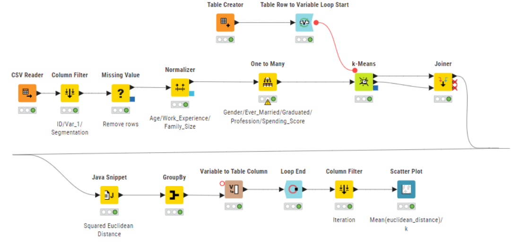
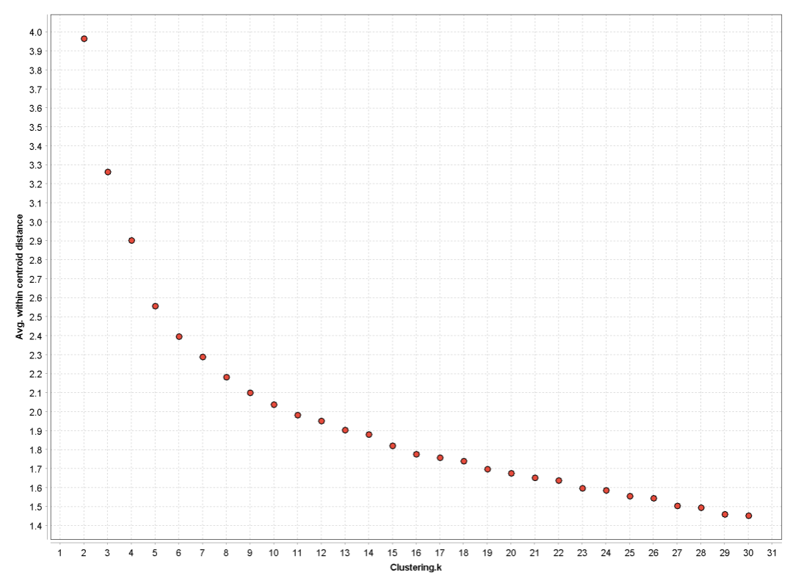

# Customer Segmentation with k-means in KNIME

Segmenting an automobile company's customers with k-means clustering, built as an automated KNIME workflow: data cleaning, encoding, normalisation, a loop over the number of clusters *k*, and an elbow analysis to choose *k*.

> **Context:** Team project in the course *Data Mining* (D0025E), Luleå University of Technology, 2025.
> **Main contribution:** I designed and built the complete KNIME workflow described below. Teammates built a parallel version in RapidMiner, and the cluster interpretation was done together.

---

## Business question

The company already divides its customers into **four segments**. We wanted to know whether an unsupervised clustering of the customer data reproduces these four groups, or whether a different number of segments would be more useful for targeting marketing campaigns.

## Data

- **8,068 customers**, one row per customer
- **Attributes used:** Gender, Ever Married, Age, Graduated, Profession, Work Experience, Spending Score, Family Size
- **Removed:** `ID` (row index only), `Segmentation` (the company's existing labels, removed so the clustering is unsupervised) and `Var_1` (not relevant for segmentation)
- **Source:** https://www.kaggle.com/datasets/vetrirah/customer?select=Train.csv

## KNIME workflow



**1. Preprocessing**

| Step | Node | What it does |
|---|---|---|
| Load | CSV Reader | Reads the raw customer data |
| Select | Column Filter | Removes `ID`, `Var_1` and `Segmentation` |
| Clean | Missing Value | Removes rows with missing values |
| Scale | Normalizer | Z-score normalisation of Age, Work Experience and Family Size |
| Encode | One to Many | One-hot encoding of Gender, Ever Married, Graduated, Profession and Spending Score |

Only the continuous variables are normalised. The one-hot columns are already on a 0–1 scale, and normalising them as well distorted the distances (in an early version this pushed the elbow to *k* = 10).

**2. Loop over *k***

- **Table Creator** holds the list of *k* values to test (the column type must be *integer*, otherwise the loop fails).
- **Table Row to Variable Loop Start** passes each *k* to the clustering as a flow variable.
- **k-Means** clusters the data for the current *k*.

**3. Evaluation inside the loop**

- **Joiner** combines each customer's cluster assignment with the coordinates of its cluster centroid.
- **Java Snippet** computes, row by row, the squared Euclidean distance between each customer and its centroid.
- **GroupBy** averages these distances over all customers (mean within-cluster distance).
- **Variable to Table Column** attaches the current *k* to the result, so the output pairs each *k* with its distance rather than with an iteration index.
- **Loop End** collects the results for all *k*.

**4. Visualisation**

- **Column Filter** drops the iteration column.
- **Scatter Plot** plots mean distance against *k* (the elbow plot).

## Results



- In KNIME, the elbow was **not clearly defined**. The parallel RapidMiner analysis showed a clearer elbow at **k = 5**.
- One likely reason for the difference is the missing-value strategy: the KNIME workflow removes incomplete rows, while the RapidMiner version replaced missing values with column averages.
- Comparing *k* = 4 with *k* = 5, the extra cluster splits the company's broad "established" segment (older, married, graduated, mixed spending) into two groups with different spending behaviour: **average spenders** and **older, lower spenders with a strong share of lawyers**.

**Recommendation:** use five segments instead of four. Keeping the "established" group as one segment risks sending the same campaign to customers with very different willingness to spend.

## Limitations

- k-means with one-hot encoded categorical variables is a simple approach. Methods designed for mixed or categorical data, such as **k-modes**, would be a natural next step.
- The choice of *k* depends on preprocessing decisions such as missing-value handling and scaling, as the difference between the two tools shows.

## Tools

KNIME Analytics Platform (free and open source). The team also used Altair AI Studio (RapidMiner) for comparison.

## How to run

1. Install [KNIME Analytics Platform](https://www.knime.com/downloads).
2. Import `workflow/customer-segmentation.knwf` (*File → Import KNIME Workflow*).
3. Point the **CSV Reader** node to your copy of the dataset.
4. Execute the workflow and open the **Scatter Plot** node to see the elbow plot.

## Repository structure

```
.
├── README.md
├── workflow/
│   └── customer-segmentation.knwf
└── images/
    ├── knime-workflow.png
    └── elbow-plot.png
```

## Credits

Team project, Luleå University of Technology (D0025E, 2025). Team members: Anders Dehlbom, Erik Vodopivec Forsman, Mattias Konnebäck, Nicole Aguiar Jakobsson and Oscar Arandes Tejerina.
